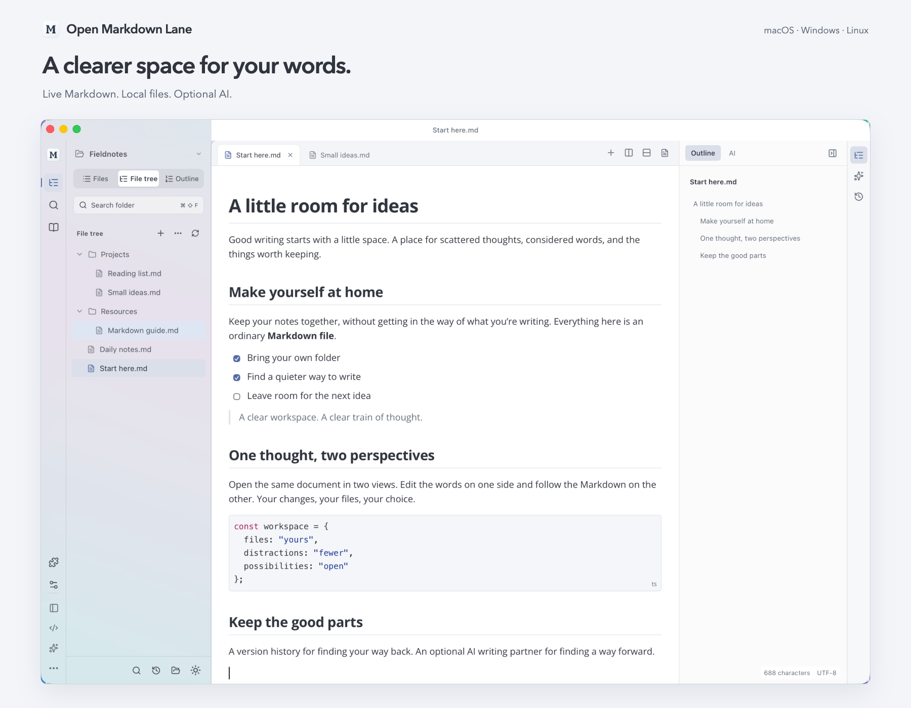
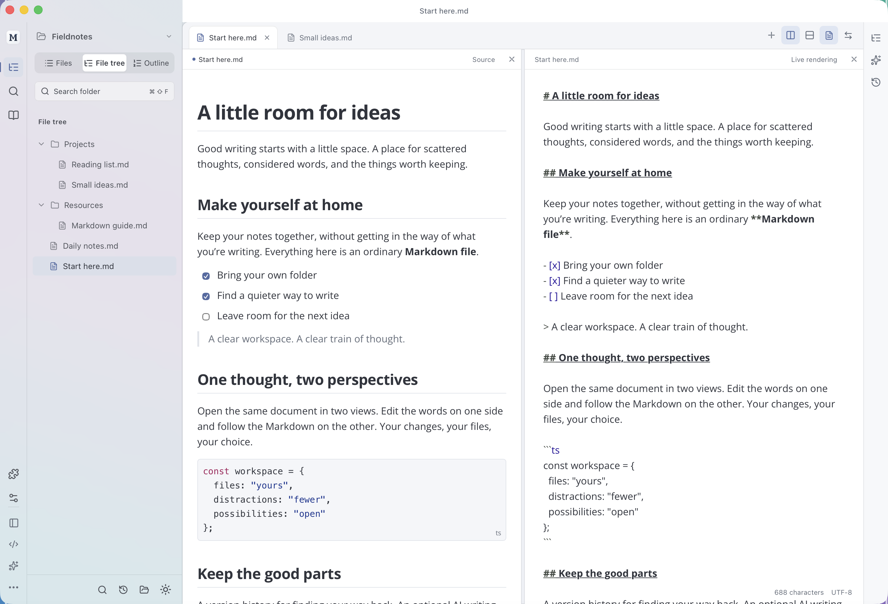

# Open Markdown Lane：本地 Markdown 写作空间

Open Markdown Lane 是一个开源 Markdown 编辑器。打开自己的文件夹，直接在正文里写，需要时切到源码。文件仍是普通的 `.md`，可以继续用其他工具打开。

项目采用 MIT 许可证，受 Typora 的行内编辑体验启发，**与 Typora 官方没有关联，也不是官方免费版**。有能力的话，欢迎[购买 Typora](https://store.typora.io/)，支持官方开发者。

## 0.26.1 的工作区

macOS 侧栏使用真正的磨砂半透明材质，能透出并模糊窗口背后的色彩，正文保持实底。系统材质明暗随当前主题同步；Windows/Linux 保留实底后备。

左边是窄图标栏和文件目录，中间是标签页与正文，右侧可以打开大纲或 AI 审阅。浅色、深色的间距和层级统一了，macOS 侧栏使用系统磨砂材质，正文保持清晰。Windows 和 Linux 使用半透明表面，不模糊桌面。

同一份文档可以开两个视图：一侧写正文，另一侧看源码，也可以两侧都编辑正文。内容与撤销历史共享，光标和滚动各自保留。普通的双文档分屏也还在。

截图来自当前版本的隔离桌面验收配置，使用自有英文示例，没有用户文档或模型密钥。应用支持英文、简体中文与跟随系统语言；升级会保留手动选择。

## 写作之外

常用 Markdown、表格与 Excel/WPS 粘贴、离线公式、Mermaid、文件夹搜索、编码选择、主题与背景图片、版本历史都已提供。AI 是可选项：接入自己的兼容 API 或本地模型，再使用选区改写、差异审阅、参考文件、目录问答和跨文档修改。应用不附带模型或免费额度，发送前应核对选中的内容与服务设置。见 [AI 配置、隐私和限制](ai.zh-CN.md)。

HTML、PDF 可直接导出；额外格式依赖可选的 Pandoc、LibreOffice 等工具。复杂文档转换可能改变排版和结构，原文件应单独保留。插件兼容也有范围，不能把支持部分原版社区插件理解为任意插件都能直接运行。

## 下载和测试范围

[README 下载区](../README.zh-CN.md#下载)提供 macOS、Windows、Linux 安装包与校验文件。macOS 面向 Apple Silicon、14 及以上系统；Windows 和 Linux 面向 x64。macOS 尚未经过 Apple 公证，Windows 安装包尚未签名。

本轮回归覆盖标签页、分屏、中文组合输入、撤销／重做、重启恢复、主题、背景图片、右键、插件和 AI 审阅。自动化组合输入不能代替所有实体输入法候选窗的人工验收。三平台发行结果及实际安装检查见[版本化验收记录](verification.md)，完整范围见[功能清单](feature-parity.md)。

拿日常文档的副本试一遍保存、撤销和导出，通常比单看功能列表更有用。报告问题时，请带上系统、版本、操作步骤和最小示例；不需要发送隐私文档或 API 密钥。

[源码](https://github.com/AniChikage/open-markdown-lane) · [报告问题](https://github.com/AniChikage/open-markdown-lane/issues/new?template=bug_report.yml)

本文使用 AI 辅助整理，功能和截图对应 0.26.1。
