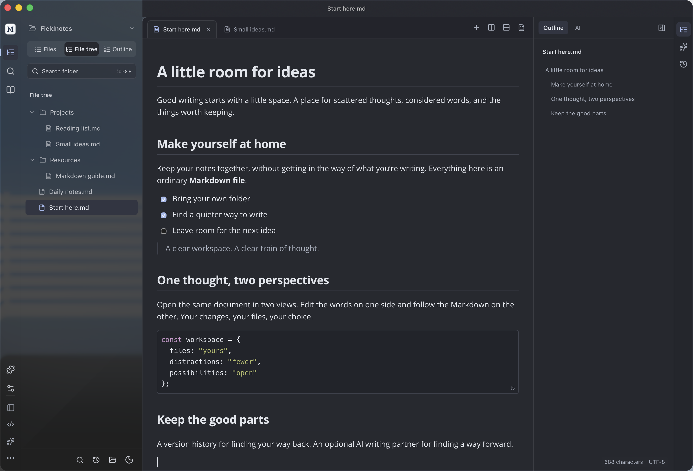

Open Markdown Lane 0.26.1 fixes the macOS frosted sidebar so the native background material can show through.

This is an independent, unofficial project, unaffiliated with Typora. If you can afford it, please [buy Typora](https://store.typora.io/) and support its official developers.

## Changes

- Replaced the nearly opaque macOS sidebar tint with a lighter translucent layer over native behind-window material. Removed redundant CSS blur on native material surfaces.
- Native material follows the current light or dark document theme, including when the operating system uses a different appearance. Inactive windows retain the frosted treatment.
- Kept opaque desktop fallbacks on Windows/Linux, the clear writing surface, and reduced-transparency and forced-color styles.
- Existing documents, recovery, themes, model configuration and editor behavior retain their storage formats.

## Downloads

- macOS 14+, Apple Silicon: DMG or ZIP.
- Windows 10/11 x64: Setup.exe or ZIP.
- Linux x64: DEB or x86_64 AppImage, plus its `.zsync` control file.

The six installers and the control file are covered by `SHA256SUMS.txt`. macOS is locally signed, not notarized; Windows is unsigned.

## Validation

Production build, strict checks and 265 unit tests passed, together with workspace, shared-view, native window/store, full native WebKit (163 editor checks) and shared-view regressions. These cover Chinese composition, exact saves, cross-pane undo/redo and real process restart. Physical IME candidate-window acceptance was not repeated.

The macOS visual check uses an owned patterned window behind the real editor and a consented display-compositor capture restricted to that editor's rectangle. Window-only snapshots are not counted as evidence of behind-window translucency. All three-platform installation and upgrade tests passed, together with Everything preview, real Ubuntu 22.04/24.04 FUSE mounts and public AppImageUpdate from 0.26.0. The published installers were downloaded and verified against their checksums. The local macOS app is updated, with document, session, view-state and settings fingerprints preserved. The superseded 0.26.0 Release and installation copies have been removed; source tags and history remain. See [the verification record](https://github.com/AniChikage/open-markdown-lane/blob/main/docs/verification.md) for the final scope and results.
